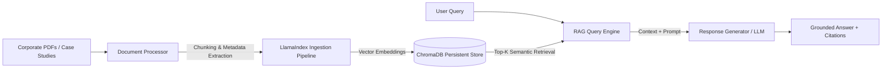

# Enterprise Knowledge Agent (RAG)

[](https://github.com/Data-science-and-analytics-by-shivansh/Enterprise-Knowledge-Agent-RAG-/actions)
[](https://www.python.org/downloads/)
[](https://www.llamaindex.ai/)
[](https://www.trychroma.com/)
[](LICENSE)

A containerized, modular Retrieval-Augmented Generation (RAG) pipeline designed to ingest, index, and query dense unstructured corporate documents (PDFs, case studies, internal SOPs) with grounded source citations.

---

## Architecture


## Key Features
* **Modular Package Architecture:** Cleanly decoupled `rag_pipeline` package covering document ingestion (`document_processor.py`), persistent vector storage (`vector_store.py`), orchestration (`pipeline.py`), and synthesis (`response_generator.py`).
* **Persistent Local Vector Store:** Uses ChromaDB to persist document embeddings across container restarts without re-indexing.
* **Production-Ready Containerization:** Multi-service `Dockerfile` and `docker-compose.yml` for reproducible deployment.
* **Automated CI & Unit Testing:** Comprehensive 131-test `pytest` suite covering document processing, vector indexing, and end-to-end query pipelines via GitHub Actions.

---

## Project Structure

```text
Enterprise-Knowledge-Agent-RAG-/
├── .github/
│   └── workflows/
│       └── ci.yml                  # Automated linting & pytest CI workflow
├── data/                           # Drop corporate PDFs & case studies here
├── scripts/
│   └── healthcheck.py              # Container & module health verification
├── src/
│   ├── __init__.py
│   └── rag_pipeline/
│       ├── document_processor.py   # PDF parsing, cleaning, and chunking logic
│       ├── vector_store.py         # ChromaDB collection management & persistence
│       ├── pipeline.py             # End-to-end LlamaIndex retrieval orchestration
│       ├── response_generator.py   # Prompt templates & grounded LLM synthesis
│       └── main.py                 # Application entry point / API server
├── tests/
│   ├── conftest.py                 # Shared pytest fixtures & mock documents
│   ├── test_document_processor.py  # Chunking & metadata validation tests
│   ├── test_vector_store.py        # ChromaDB CRUD & retrieval tests
│   └── test_pipeline.py            # End-to-end RAG integration tests
├── .env.example                    # Environment variable template
├── .gitignore
├── Dockerfile
├── docker-compose.yml
├── LICENSE
├── README.md
└── requirements.txt

----

Quickstart
Option 1: Run with Docker (Recommended)
Clone the repository:

Bash
git clone https://github.com/Data-science-and-analytics-by-shivansh/Enterprise-Knowledge-Agent-RAG-.git
cd Enterprise-Knowledge-Agent-RAG-
Configure environment variables:

Bash
cp .env.example .env
# Add your OPENAI_API_KEY (or local LLM endpoint) inside .env
Add documents & launch:
Place your PDFs inside the ./data folder, then run:

Bash
docker-compose up --build
Option 2: Run Locally
Bash
python -m venv venv
source venv/bin/activate  # On Windows: .\venv\Scripts\Activate.ps1
pip install -r requirements.txt

cp .env.example .env
PYTHONPATH=src python src/rag_pipeline/main.py
Running Tests
Execute the 131-test unit and integration suite with pytest:

Bash
# Linux / macOS
PYTHONPATH=src pytest -v

# Windows PowerShell
$env:PYTHONPATH="src"; python -m pytest -v

----

Roadmap & Contributions
Contributions are welcome! Check the Issues tab for good first issue tasks:

[ ] Add hybrid search (BM25 + dense vector retrieval) with cross-encoder reranking

[ ] Support DOCX, Markdown, and Confluence ingestion connectors

[ ] Add RAGAS evaluation benchmark script (faithfulness & answer_relevancy)

[ ] Add streaming response support via FastAPI SSE

----
